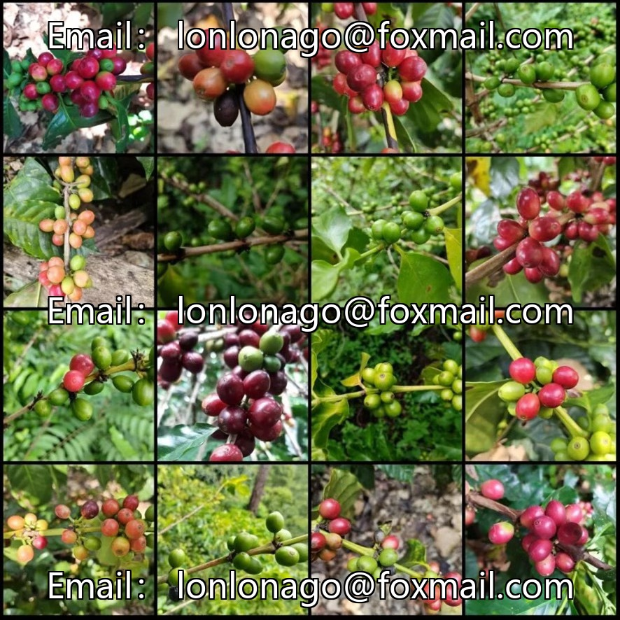
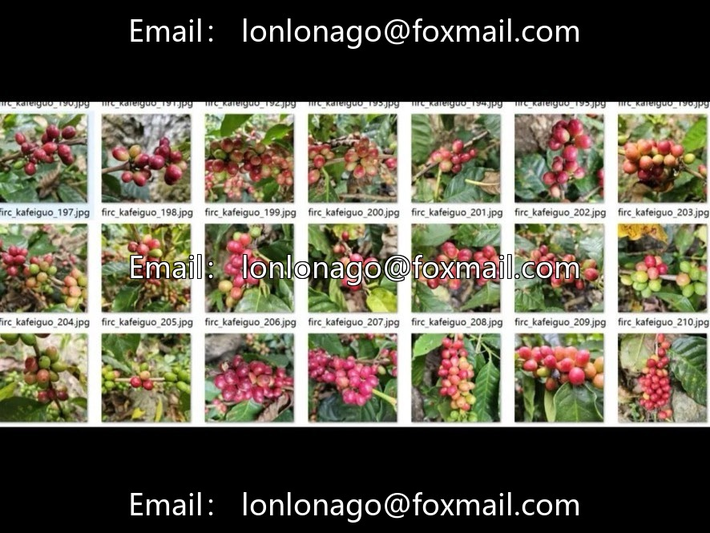
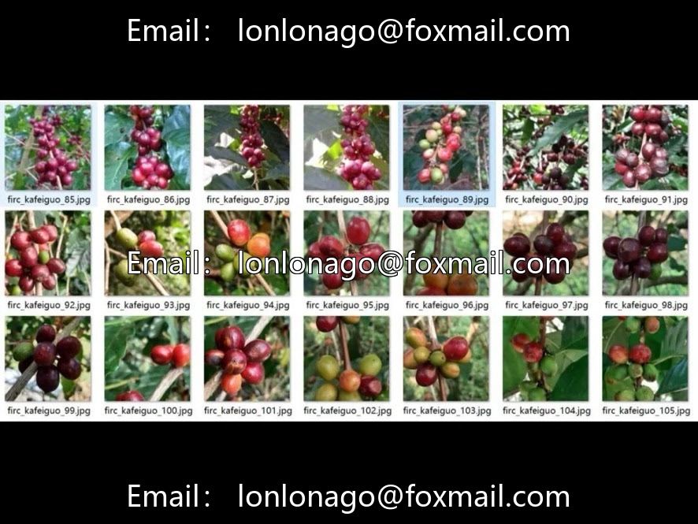
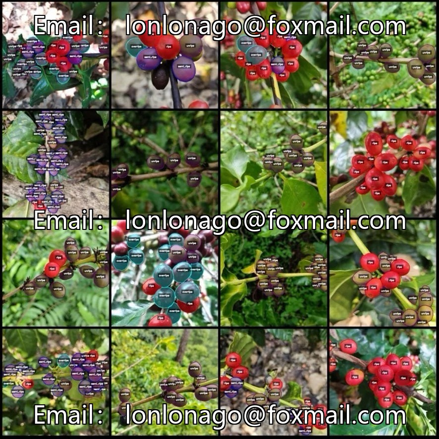

# Coffee fruit maturity recognition segmentation dataset, LabelMe format, total 2045 images

## Body

Coffee fruit maturity recognition segmentation dataset, LabelMe format, consists of 2045 images corresponding to 2045 json annotations files. There are four categories: overripe (over-ripe), ripe (ripe), semi-ripe (semi-ripe), unripe (unripe). The number of annotation boxes for each category is as follows: overripe 4791, ripe 13275, semi-ripe 6391, unripe 12851, total annotation boxes 37308. The dataset is labeled using labelme 5.5.0 with image resolution of 800x800 and polygon annotation rules.

The dataset only contains jpg images and json annotations files, without mask files. You need to convert them into mask or yolo/coco format for semantic segmentation or instance segmentation. This dataset does not guarantee the accuracy of the training model or weight files.

Virtual materials, once sold, are non-refundable.
Interested friends, click "I want" to proceed.

## Images

## Payment

Here is a pay link on Stripe ( https://buy.stripe.com/3cs8yP7sY87d0vu9AB ). Please contact me lonlonago@foxmail.com after funding $89, and I will send you a complete data files , thank you!

